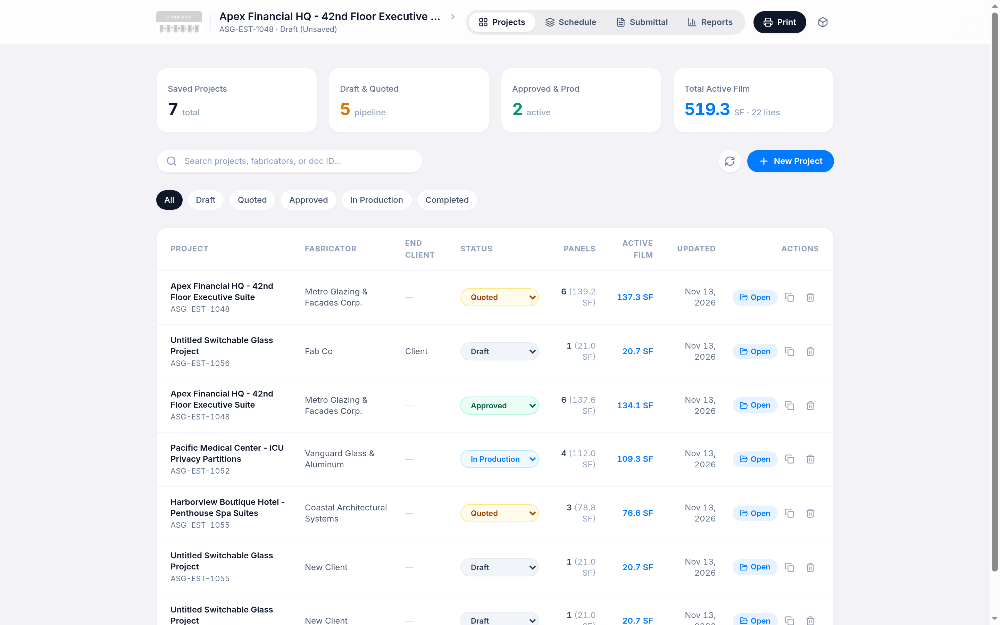
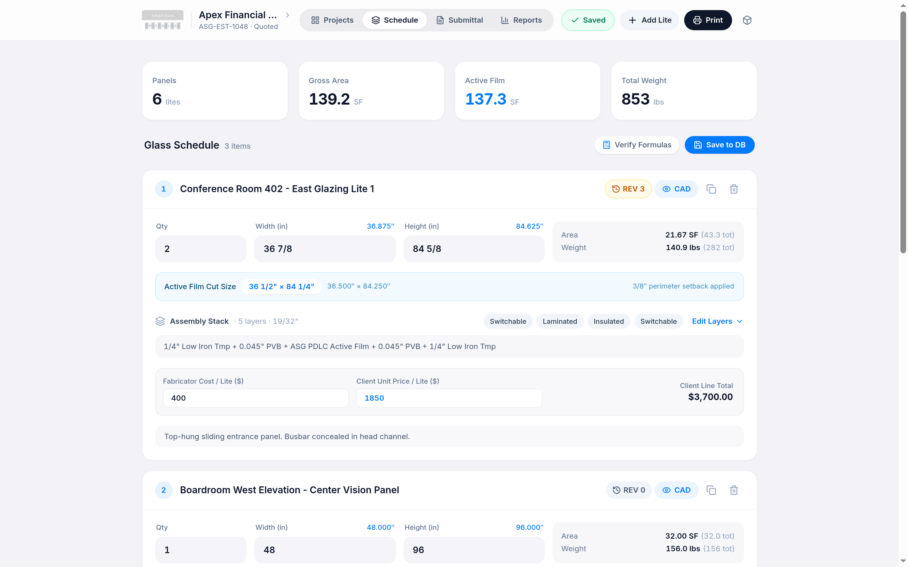
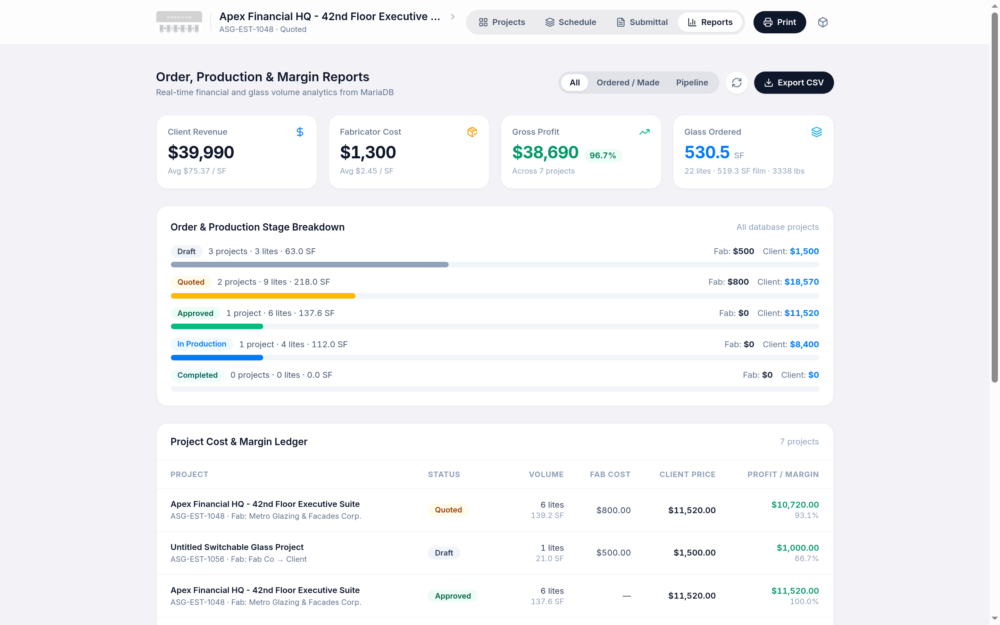

# ASG Estimate, CAD Shop Drawing & Proposal Platform

A full-stack commercial switchable privacy glass (PDLC) estimating, technical CAD shop drawing, and client proposal platform built for **American Switch Glass (ASG)** as a glazing contractor.

---

## Key Features

### 1. Projects Dashboard & Full CRUD (MariaDB)
- **KPI Overview:** Tracks total saved projects, active pipeline (`Draft` / `Quoted`), committed production (`Approved` / `In Production`), and total active PDLC film square footage.
- **Project Management:** Create, open, duplicate, delete, search (by project name, Doc ID, Fabricator, or End Client), and filter projects by status, with inline status updates and an **End Client** column persisted to **MariaDB**.

### 2. Glass Schedule Editor, Revision Tracking & Engineering Engine
- **Fractional Dimension Parser:** Accepts mixed fractions (`36 1/2"`, `20-1/2`), pure fractions (`3/16`), and decimals (`36.625`).
- **Active PDLC Film Calculation:** Automatically applies the standard `3/8"` (`0.375"`) perimeter hermetic edge-seal setback to compute exact film cut dimensions.
- **Glass Weight & Thickness:** Computes nominal assembly thickness and glass weight (`13 lbs/sq ft` per inch of glass thickness).
- **Assembly Layer Stack & Presets:** One-click presets (`Switchable 5/8" Nom.`, `Laminated 9/16" Nom.`, `IGU 1-3/8" Nom.`, `Acoustic/Security 7/8" Nom.`) plus a full outboard-to-inboard layer editor with selectable **busbar locations** (`Top Center`, `Top Left`, `Top Right`, `Bottom`, `Right Side`).
- **Per-Lite CAD Revision Tracking & History Recall:** Automatically increments each lite's individual drawing revision (`REV 0`, `REV 1`, ...) whenever its **Qty, Width, Height, or Assembly Stack** changes between saves, records a human-readable diff + full spec snapshot, and lets you inspect or **Recall Spec** from any past revision.
- **Two-Stage Pricing:** Track internal **Fabricator Cost / Lite ($)** alongside **Client Unit Price / Lite ($)** and live line totals.

### 3. Compressed Attachments & Built-In DXF/DWG Web Viewer
- **Automatic Storage Compression:** Raster photos (`JPG`, `PNG`, `WebP`, `BMP`, `TIFF`, `GIF`) are auto-oriented, resized to max `1920px`, and converted to **WebP** via `sharp` (with `heic-convert` for iPhone `HEIC`/`HEIF` photos); PDFs (`>150 KB`) are optimized with Ghostscript (`/ebook`); and CAD/text documents (`.dxf`, `.dwg`, `.svg`, `.csv`, `.txt`) are transparently `gzip`-compressed on disk and decompressed on download/preview.
- **Interactive DXF & DWG CAD Viewer:** Preview `.dxf` (`dxf-parser`) and `.dwg` (lazy-loaded `@mlightcad/libredwg-web` WASM) drawings directly in the browser with pan, zoom, fit-to-screen, dark/light canvas toggle, and CAD layer visibility controls.
- **Inline Preview & Download:** Lightbox image preview, embedded PDF viewer, one-click download, and deletion.

### 4. Dual Printable 8.5" × 11" Submittals
- **Fabricator RFQ Mode:** Generates a **Fabrication Estimate Request** addressed to the Glass Fabricator alongside **CAD Shop Drawings** (elevation view with dynamic busbar placement, lamination cross-section detail, and glazing/wiring notes).
- **Client Proposal Mode:** Generates an end-client **Commercial Proposal** with unit pricing, extended totals, commercial terms, and client acceptance signature block (with optional CAD sheets attached).
- **Smart PDF Filename:** Automatically sets the browser print/PDF filename to the project's Document ID (e.g., `ASG-EST-1055.pdf`).

### 5. Production, Cost & Margin Reports
- **Financial & Volume Analytics:** View Client Revenue, Fabricator Cost, Gross Profit, Margin %, and average `$/SF` across all projects or filtered by `Ordered / Made` vs. `Pipeline`.
- **Stage & Material Breakdowns:** Visual pipeline stage breakdown and aggregated glass makeup/specification totals.
- **CSV Export:** One-click export of the full financial and production ledger.

---

## Screenshots

### Projects Dashboard


### Glass Schedule Configurator & Revision Tracking


### CAD Fabrication Drawing & Assembly Specification


### Production, Cost & Margin Reports


---

## Tech Stack

- **Frontend:** React 19, TypeScript, Vite, Tailwind CSS v4, Lucide Icons, `dxf-parser`, `@mlightcad/libredwg-web`
- **Backend:** Node.js, Express, `mysql2`, `multer`, `sharp`, `heic-convert`, Ghostscript
- **Database & Admin:** MariaDB 11, phpMyAdmin
- **Infrastructure:** Docker Compose, Nginx Alpine (static serving + `/api/` reverse proxy)

---

## Quick Start (Docker Compose)

### 1. Start the Full Stack
```bash
docker compose up -d --build
```

### 2. Services & Ports
| Service | Container | Default Host Port | URL / Connection |
| :--- | :--- | :--- | :--- |
| **Web App (Nginx)** | `asg-estimator-app` | `8083` | http://localhost:8083 |
| **phpMyAdmin** | `asg-phpmyadmin` | `8084` | http://localhost:8084 |
| **Backend API** | `asg-backend` | `4000` | http://localhost:4000 |
| **MariaDB 11** | `asg-mariadb` | `3308` | `asg_estimator` (`asg_user` / `asg_pass`) |

> Ports can be customized via environment variables (`PORT`, `PMA_PORT`, `API_PORT`, `DB_PORT`).

### 3. Manage Containers
```bash
# View logs
docker compose logs -f

# Stop services
docker compose down
```

---

## Local Development (Without Docker for App)

1. Install dependencies:
   ```bash
   npm install --legacy-peer-deps
   ```
2. Start MariaDB (e.g., via `docker compose up -d mariadb`), then run the API server and Vite frontend:
   ```bash
   npx tsx server/index.ts
   npm run dev
   ```
3. Type-check & build:
   ```bash
   npm run lint
   npm run build
   ```

---

## API Endpoints

| Method | Endpoint | Description |
| :--- | :--- | :--- |
| `GET` | `/api/health` | Database connectivity check |
| `GET` | `/api/projects` | List all saved projects with summary metrics |
| `GET` | `/api/projects/:id` | Get full project metadata and line items |
| `POST` | `/api/projects` | Create a new project |
| `PUT` | `/api/projects/:id` | Update project metadata, status, and line items |
| `PATCH` | `/api/projects/:id/status` | Quick-update project status |
| `DELETE` | `/api/projects/:id` | Delete a project and its attachments |
| `GET` | `/api/projects/:id/attachments` | List project attachments |
| `POST` | `/api/projects/:id/attachments` | Upload an attachment (`multipart/form-data`) |
| `GET` | `/api/attachments/:attachmentId` | Preview or download (`?download=1`) an attachment |
| `DELETE` | `/api/attachments/:attachmentId` | Delete an attachment |
| `GET` | `/api/reports/summary` | Aggregated financial, status, and material report |

